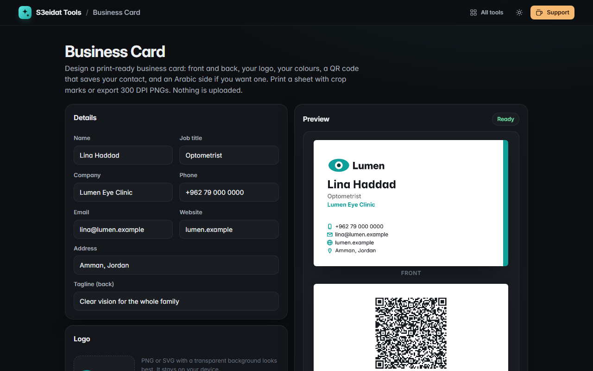

# Business Card

> Design print-ready business cards with a QR vCard. Free, private, and it runs entirely in your browser.

### ▶ [Open Business Card](https://s3eidat.github.io/business-card/)



## Features

- **Two sizes**: 85 × 55 mm (standard) and 3.5 × 2 in (US)
- **Four templates**: Classic, Band, Centered, Minimal, with your **logo** (from a local file) and your **colours** (or a preset)
- **Front and back**: the back can be your logo on colour, a **QR code that saves your contact** (vCard 3.0, with commas and semicolons escaped), an **Arabic version** of the front laid out right to left, or nothing
- Optional **QR on the front**, and a `.vcf` contact file download
- **PNG export at 300 DPI**: 1004 × 650 px for 85 × 55 mm, 1050 × 600 px for 3.5 × 2 in, with the DPI written into the PNG
- **Print sheet**: 10 cards per A4 (2 × 5) or Letter, centred, positioned in millimetres with **crop marks**; fronts, backs, or both (backs are mirrored for long-edge duplex). Optional 4 mm gap between cards

Tips: print at 100% ("Actual size"). There is no bleed, so for full-colour backgrounds a guillotine gives the cleanest edge.

## Privacy

Your details and logo never leave your device. Settings are remembered in this browser's local storage only.
There is no server, no account, no analytics. The page ships with a strict Content-Security-Policy
(`connect-src 'self'`), so the browser itself blocks any attempt to send data anywhere.

## Run it yourself

It's plain HTML, CSS and JavaScript with no build step:

```bash
git clone https://github.com/s3eidat/business-card
cd business-card
python -m http.server 8000
```

Then open http://localhost:8000.

## Credits

QR codes by [qrcode-generator](https://github.com/kazuhikoarase/qrcode-generator) (Kazuhiko Arase, MIT).

## Support

If this saved you time, **[buy me a coffee ☕](https://s3eidat.github.io/coffee/)**. It keeps every tool free.

---

Part of **[S3eidat Tools](https://s3eidat.github.io/)**: 100+ free, private tools that run in your browser. MIT licensed.
